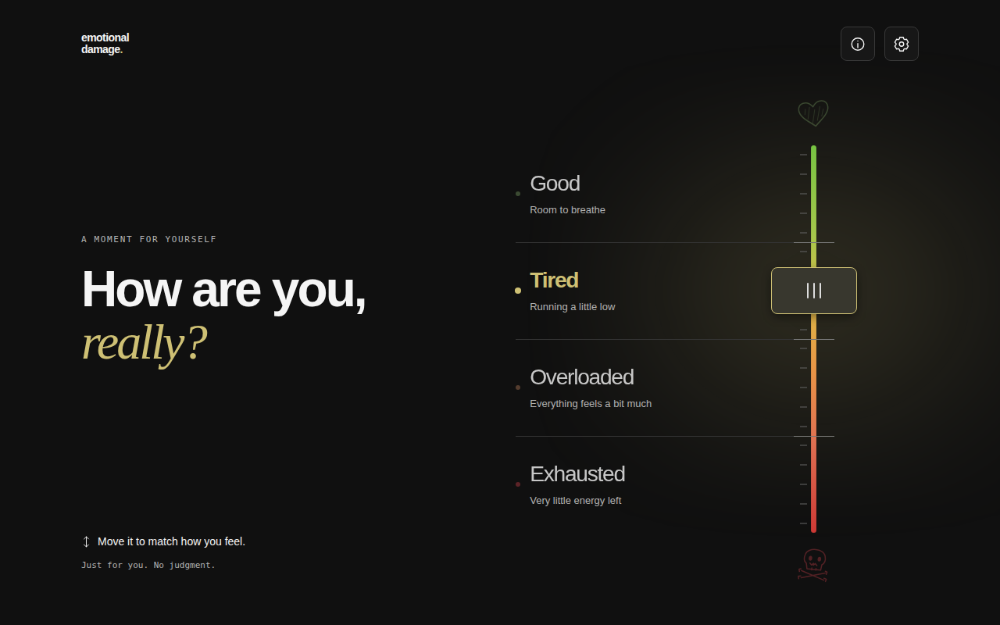
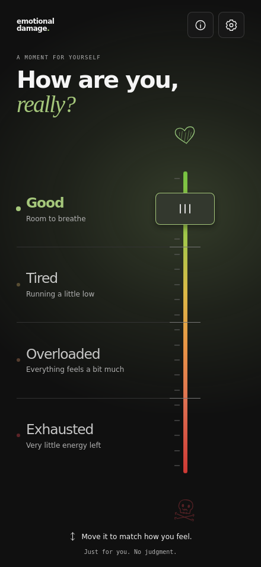

# Emotional Damage

A one-screen reflection fidget. Move the gauge to match how you feel; there’s no
right answer.

**[Open the app](https://stress.valeriizhyla.com/)**

<p align="center">
  
  &nbsp;
  
</p>

- Four levels: Good, Tired, Overloaded and Exhausted, with twenty positions.
- Drag the marker, tap a level, or focus the gauge and use the arrow keys.
- English, German and Russian. Layouts for phones and larger screens.
- Offline use after the first online visit finishes caching; add it to your home screen for quick access.

No account, tracking or backend. Your last position and language stay in this
browser on this device. They don’t sync between devices, and clearing site data
removes them. The scale is a prompt to reflect, not a test.

## Run locally

With Git and Python 3 installed:

```bash
git clone https://github.com/ValeriiZhyla/emotional-damage.git
cd emotional-damage
python3 -m http.server 18123 --bind 127.0.0.1 --directory public
```

Open [127.0.0.1:18123](http://127.0.0.1:18123). No build or package installation is
needed to preview the app. Node.js is only needed for development tools.

## More

- [Development and checks](docs/development.md)
- [Self-hosting and operations](docs/deployment.md)
- [Documentation index and decisions](docs/index.md)

Licensed under [MIT](LICENSE).
